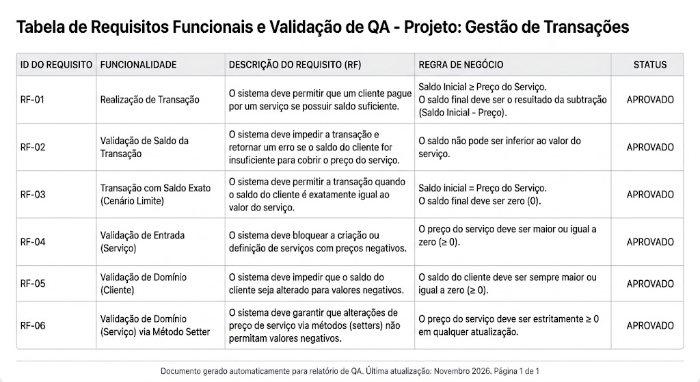

# Prova para jovem aprendiz de desenvolvimento

## Instruções de execução

1. Rodar o arquivo Main da aplicação dentro da IDE;
2. Responder às perguntas no terminal com "s" ou "n" dependendo da funcionalidade escolhida para usar;
3. Para criação de operação cliente serviço responder às perguntas no terminal inserindo os dados de cliente e serviço (nome, saldo/preço) com valores (string, inteiro);
4. Para verificação de testes apenas responder a última pergunta do terminal com "s".

## Tabela de testes

## Perguntas

### Como você dividiu o problema para começar?

 Dividi da seguinte forma: Qual tecnologia utilizar, como faria a organização do projeto e por fim como faria a documentação.

### Qual dificuldade ou dúvida encontrou e o que fez para avançar?

 Não encontrei dificuldades no projeto.

### Qual informação ou sugestão consultada você conferiu?

 Conferi as regras de formatação das strings.

### O que mudou na solução depois dos seus testes?

 Os testes confirmaram a funcionalidade da aplicação.

### Se tivesse mais 15 minutos, o que verificaria ou melhoraria primeiro e por quê?

 Para este projeto eu adicionaria uma forma de cadastro simulando um banco de dados utilizando ferramentas presentes no próprio Java.

## Ferramentas

Utilizei apenas da ferramente de IA Gemini exclusivamente para me auxiliar na criação da tabela de testes. 

